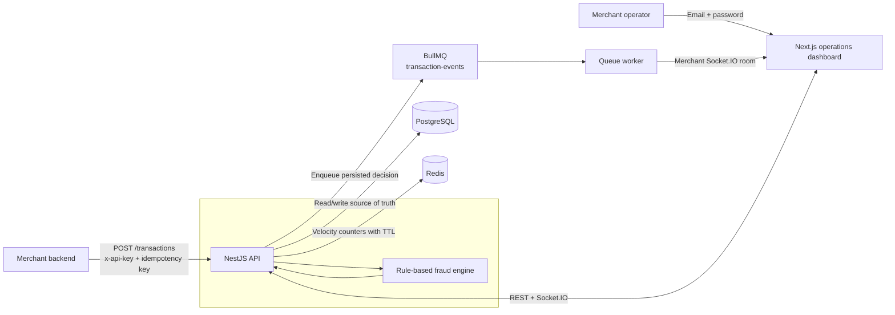
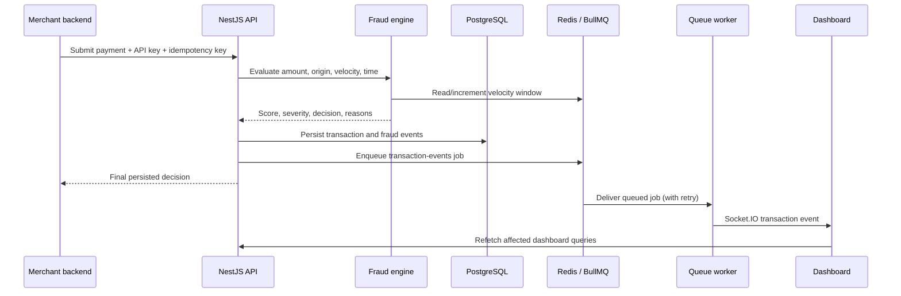
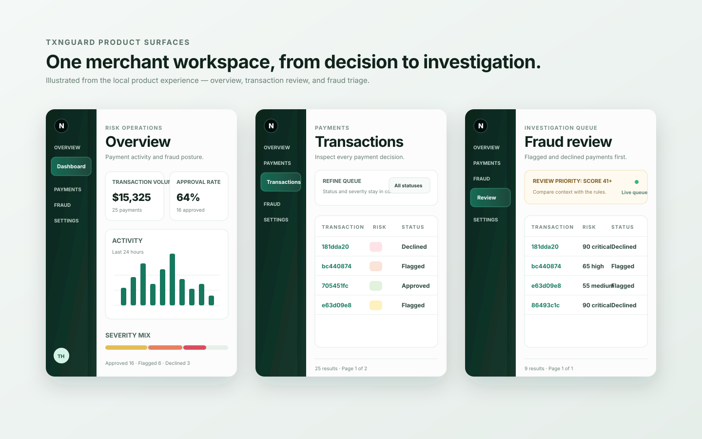

# TxnGuard

> A real-time fraud-operations workspace for merchant payment flows.

TxnGuard receives a merchant payment event, evaluates deterministic fraud rules, persists the result, and gives an operations team an immediately usable investigation surface. It is deliberately built as an operational product—not a checkout page or a generic analytics demo.

## What problem does it solve?

Payment decisions are only useful when they are explainable and actionable. A merchant needs to know **what was accepted, what was stopped, why a rule changed the outcome, and whether the dashboard reflects that decision now**.

TxnGuard closes that loop:

1. A merchant backend submits a payment with its API key and idempotency key.
2. The API evaluates country mismatch, high-value, velocity, and overnight-risk signals.
3. The decision and audit trail are written to PostgreSQL before the response is returned.
4. A BullMQ job delivers the already-persisted decision to the merchant’s Socket.IO room.
5. The dashboard refreshes its operational view without a browser reload.

This split matters: payment ingestion stays durable even when realtime delivery is delayed or Redis is temporarily unavailable. BullMQ retries notification delivery; it never makes a merchant retry a charge request.

### Who uses it?

| Actor | Access | Primary job |
| --- | --- | --- |
| Merchant operator | Email + password dashboard session | Monitor payment health, inspect decisions, investigate risky payments, rotate API keys. |
| Merchant backend | `x-api-key` | Submit an idempotent payment decision request. |
| Fraud analyst | Dashboard access | Work flagged and declined payments from the investigation queue. |

## Architecture

### System map



| Component | Responsibility |
| --- | --- |
| Next.js | Merchant dashboard: overview, transaction filters, drawer-based audit detail, fraud review, settings. |
| NestJS | Authentication, merchant boundaries, transaction ingestion, fraud decisioning, analytics, OpenAPI. |
| PostgreSQL + Drizzle | Durable merchant, transaction, refresh-token and fraud-event records. |
| Redis | Fixed-window velocity counts, API-key rotation limit, BullMQ backing store. |
| BullMQ + Socket.IO | Decoupled, retryable delivery of persisted decisions to the open dashboard. |
| Shared package | TypeScript contracts and Zod-backed data shapes used across API and web. |

### Decision and delivery sequence



### Trust boundaries

- API keys are for machine-to-machine transaction ingestion; they are never used to sign in to the dashboard.
- Email/password creates a merchant-scoped dashboard session via access and refresh tokens.
- Every list, detail, analytics and Socket.IO subscription is merchant-scoped.
- API-key rotation is rate-limited per merchant (three rotations per hour by default).
- PostgreSQL remains authoritative; Redis holds disposable counters and queue state.

## Product surfaces

The dashboard is designed for calm, dense operational work: clear status states, investigation-first severity cues, responsive filter controls, and an inline audit drawer instead of disruptive detail navigation.



### Overview

- Shows volume, approval rate, average risk and immediate attention count for a selectable time range.
- Activity buckets and severity bands are interactive: selecting one opens the corresponding filtered transactions or fraud-review queue.
- Recent payments open the same audit drawer used across the workspace.

### Transactions

- Status and severity filters update in place rather than remounting the page.
- Pagination works on both the standard table and responsive card presentation.
- Selecting a row opens its payment context and fraud-event audit trail in a side panel.

### Fraud review

- Starts with a useful default queue: flagged and declined payments whose score is 41 or more.
- Filtered links retain context and show **Show all** only when there is active context to clear.
- Critical, high, and medium severity views are reachable directly from the overview.

## Fraud rules in v1

| Signal | Effect |
| --- | --- |
| Card country and IP country differ | Adds fraud score. |
| High-value amount | Adds fraud score. |
| Merchant velocity threshold exceeded | Adds fraud score using a Redis fixed window. |
| High-value payment between 00:00–05:00 UTC | Adds fraud score. |

The accumulated score maps to `none`, `low`, `medium`, `high`, or `critical` severity, and then to `approved`, `flagged`, or `declined` status. Every applied rule is retained in the audit trail.

## API integration

Register a merchant in the dashboard, then use the one-time API key from registration or a rotated key from **Settings**.

```bash
curl -X POST http://localhost:3001/transactions \
  -H "content-type: application/json" \
  -H "x-api-key: YOUR_API_KEY" \
  -d '{
    "amountMinor": 125000,
    "currency": "USD",
    "cardBin": "411111",
    "cardCountry": "US",
    "ipAddress": "203.0.113.42",
    "ipCountry": "TR",
    "idempotencyKey": "demo-transaction-0001"
  }'
```

The country mismatch and high amount make this a useful investigation example. Reusing the same idempotency key returns the established decision rather than creating a second payment.

## Demo the live workflow

With the dashboard open, run the demo stream from a separate terminal:

```bash
export TXNGUARD_API_KEY='tg_live_your_key_here'
make demo-flow
```

The stream submits nine mixed payment events. On a fresh velocity window, expect six approved, two flagged, and one declined decision. Verify the result in **Overview**, **Transactions**, and **Fraud review** without refreshing the browser.

To see the delivery path paced one event at a time:

```bash
export TXNGUARD_API_KEY='tg_live_your_key_here'
make live-incident
```

The API persists the decision first, BullMQ queues its delivery, and Socket.IO updates the open dashboard. Wait 60 seconds between demo runs if you want a fresh velocity window.

## Repository layout

```text
apps/
  api/        NestJS API, Drizzle schema, fraud engine, queue and realtime gateway
  web/        Next.js merchant operations dashboard
packages/
  shared/     Shared TypeScript contracts
scripts/      Repeatable demo payment streams
docs/images/  Versioned README product visual
```

## Quality and delivery

```bash
make check
```

This runs workspace type checks, production builds, tests, and Docker Compose validation. The GitHub Actions workflow runs the same quality gate pieces on every push and pull request. Turbo’s `typecheck` task builds dependency packages first, so `@txnguard/shared` declarations exist in a clean CI checkout.

### Current scope

This is a portfolio-grade MVP, not a payment processor. The next production-hardening priorities are a durable outbox for transaction-to-queue publishing, automated API/UI coverage, atomic idempotency conflict handling, wider endpoint rate limiting, observability, secrets management, retention controls, and formal fraud-review workflows.

## Local installation

### Prerequisites

- Node.js 22+
- pnpm 11+
- Docker Desktop

### Quick start

```bash
make setup
make dev
```

`make setup` installs dependencies, creates `.env` from the example when needed, starts PostgreSQL and Redis, then applies migrations. `make dev` starts both the API and dashboard.

| Service | Address |
| --- | --- |
| Dashboard | [http://localhost:3000](http://localhost:3000) |
| API | [http://localhost:3001](http://localhost:3001) |
| API reference | [http://localhost:3001/docs](http://localhost:3001/docs) |
| PostgreSQL | `localhost:5433` |
| Redis | `localhost:6379` |

### Manual equivalent

```bash
pnpm install
cp .env.example .env
docker compose up -d
pnpm --filter @txnguard/api db:migrate
pnpm dev
```

### Useful commands

| Command | Purpose |
| --- | --- |
| `make infra-up` / `make infra-down` | Start or stop PostgreSQL and Redis. |
| `make infra-status` | Check local infrastructure health. |
| `make migrate` / `make migration` | Apply or generate Drizzle migrations. |
| `make api` / `make web` | Start one application only. |
| `make demo-flow` | Send the mixed demo stream. |
| `make live-incident` | Demonstrate BullMQ + Socket.IO delivery. |
| `make check` | Run the local quality gate. |

Copy `.env.example` to `.env` for local development. Keep `.env` out of version control and use high-entropy, unique JWT secrets outside local development.
